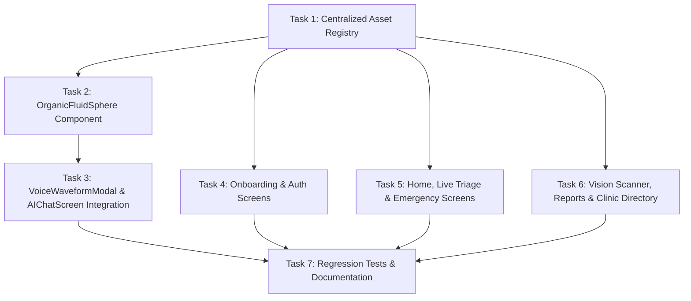

# Implementation Plan: 3D Illustrations & Animated Organic Sphere

**Branch:** `feature/centralized-ui-design-system`  
**Status:** Completed (see [`walkthrough.md`](../../walkthrough.md) for implementation and verification details).
**Document:** [`docs/plans/2026-10-17-3d-illustrations-and-animated-sphere.md`](file:///c:/Users/USER/Desktop/saas%20projects/ai-med-app/docs/plans/2026-10-17-3d-illustrations-and-animated-sphere.md)

---

## Plan Overview

This plan covers two coordinated enhancements:
1. **Integration of the 10 Generated 3D Medical Illustrations** from `mobile/assets/illustrations/` into their respective screens with responsive framing, subtle glassmorphic overlays, and typed fallback handling for the 2 pending illustrations.
2. **Implementation of `OrganicFluidSphere`**: A 60fps animated component featuring non-uniform squish-and-stretch fluid physics, concentric acoustic halo ripples, and multi-layer gradient light currents for voice recording in [`VoiceWaveformModal.tsx`](file:///c:/Users/USER/Desktop/saas%20projects/ai-med-app/mobile/src/components/chat/VoiceWaveformModal.tsx) and the [`AIChatScreen.tsx`](file:///c:/Users/USER/Desktop/saas%20projects/ai-med-app/mobile/src/screens/AIChatScreen.tsx) welcome state.

---

## Phased Tasks & Checkpoints

### Tasks Breakdown

- **Task 1: Centralized 3D Illustration Asset Registry (`mobile/src/assets/illustrations.ts`)**
  - Strongly-typed `ILLUSTRATIONS` dictionary mapping the 10 image files in `mobile/assets/illustrations/`.
  - Graceful `getIllustration(key)` resolver providing safe null fallbacks for the 2 pending assets (`neuralOrb` and `diagnosticMolecule`).
  - Unit test in `mobile/src/assets/__tests__/illustrations.test.ts`.

- **Task 2: Build `OrganicFluidSphere` Component (`mobile/src/components/ui/OrganicFluidSphere.tsx`)**
  - High-performance, 60fps React Native `Animated` component (`useNativeDriver: true`).
  - Non-uniform squish & stretch: phase-shifted `scaleX` and `scaleY` oscillation.
  - Expanding concentric acoustic halo rings (`scale: 1.0 -> 1.75`, `opacity: 0.5 -> 0.0`).
  - Palette gradient layers (`#0e88a0`, `#0f333a`, `#b1c8d8`) with specular reflection drift.
  - Three distinct states: `'idle'`, `'recording'` (reactive to listening), and `'thinking'` (agent speaking/processing).
  - Unit test in `mobile/src/components/ui/__tests__/OrganicFluidSphere.test.tsx`.

- **Task 3: Wire `OrganicFluidSphere` into Voice Modal & AI Chat Screen**
  - Update [`VoiceWaveformModal.tsx`](file:///c:/Users/USER/Desktop/saas%20projects/ai-med-app/mobile/src/components/chat/VoiceWaveformModal.tsx): replace static circle with animated `<OrganicFluidSphere state={isAgentSpeaking ? 'thinking' : 'recording'} />`.
  - Update [`AIChatScreen.tsx`](file:///c:/Users/USER/Desktop/saas%20projects/ai-med-app/mobile/src/screens/AIChatScreen.tsx): replace placeholder orb in empty chat state with `<OrganicFluidSphere state="idle" />`.

- **Task 4: Integrate 3D Illustrations into Onboarding & Auth Screens**
  - [`SplashScreen.tsx`](file:///c:/Users/USER/Desktop/saas%20projects/ai-med-app/mobile/src/screens/SplashScreen.tsx): embed 3D Laso+ Emblem (`Medical_emblem_with_mobius_loop_2K_20261017115025.jpg`).
  - [`WelcomeScreen.tsx`](file:///c:/Users/USER/Desktop/saas%20projects/ai-med-app/mobile/src/screens/WelcomeScreen.tsx): embed 3D Stethoscope & Shield (`Medical_shield_and_stethoscope_h._2K_20261017115021.jpg`).

- **Task 5: Integrate 3D Illustrations into Dashboard & Emergency Screens**
  - [`HomeScreen.tsx`](file:///c:/Users/USER/Desktop/saas%20projects/ai-med-app/mobile/src/screens/HomeScreen.tsx): embed 3D Heart Biometric Orb in Vitals Hero and 3D First-Aid Kit in quick actions.
  - [`LiveTriageScreen.tsx`](file:///c:/Users/USER/Desktop/saas%20projects/ai-med-app/mobile/src/screens/LiveTriageScreen.tsx): embed 3D Emergency Siren Beacon with red radiant glow.
  - [`EmergencyStepScreen.tsx`](file:///c:/Users/USER/Desktop/saas%20projects/ai-med-app/mobile/src/screens/EmergencyStepScreen.tsx): embed 3D CPR Anatomical Guide.
  - [`EmergencySummaryScreen.tsx`](file:///c:/Users/USER/Desktop/saas%20projects/ai-med-app/mobile/src/screens/EmergencySummaryScreen.tsx): embed 3D Medical Achievement Badge.

- **Task 6: Integrate 3D Illustrations into Vision Scanner, Reports & Directory**
  - [`WoundScannerScreen.tsx`](file:///c:/Users/USER/Desktop/saas%20projects/ai-med-app/mobile/src/screens/WoundScannerScreen.tsx): embed 3D Depth Scanner Reticle & Mesh.
  - [`ReportPreviewScreen.tsx`](file:///c:/Users/USER/Desktop/saas%20projects/ai-med-app/mobile/src/screens/ReportPreviewScreen.tsx): embed 3D Certified Medical Capsule.
  - [`ProviderListScreen.tsx`](file:///c:/Users/USER/Desktop/saas%20projects/ai-med-app/mobile/src/screens/ProviderListScreen.tsx) & `.web.tsx`: embed 3D Hospital & Locator Pin.

- **Task 7: Full Regression Verification & Commit**
  - Run `cd mobile && npx tsc --noEmit` (ensure 0 errors).
  - Run `cd backend && npm run test:mobile` (ensure all test suites pass).
  - Commit all changes to `feature/centralized-ui-design-system`.
