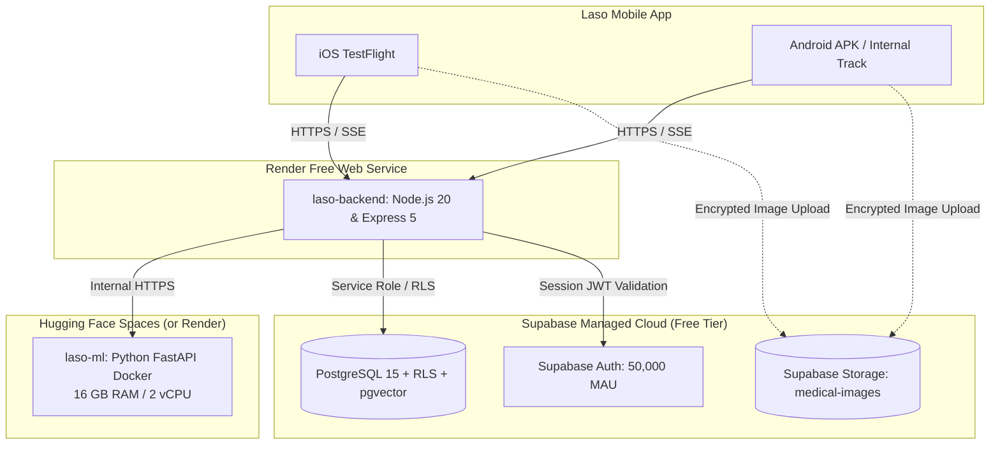

# Laso: Master Production Deployment & Scaling Plan
**Document Version:** 2.0  
**Target Application:** Laso – AI Emergency Triage, First Aid & Clinical Telehealth Platform  
**Scope:** Staged Deployment Blueprint (Free Cloud Tier $\rightarrow$ Scale to 1,000,000 Users), Continuous Delivery, and Comprehensive Update Strategy  

---

## 1. Executive Summary & Purpose

This document defines the operational launch and scaling blueprint for **Laso** (named after the Greek goddess of healing and recuperation). It maps the transition from local development through a **$0/month Free Cloud Tier** into a multi-region, high-availability architecture capable of supporting **1,000,000+ patients**.

It establishes:
1. **Pre-Deployment Automated Verification Gates** (161 automated tests across Node.js, Mobile, and Python).
2. **Phase 0: Zero-Cost Bootstrap Architecture** (Supabase Free + Render + Hugging Face Spaces).
3. **Phased Enterprise Migration Roadmap** (Free Tier $\rightarrow$ 25K $\rightarrow$ 100K $\rightarrow$ 500K $\rightarrow$ 1M+ users).
4. **Comprehensive Update Strategy**:
   - Mobile Over-the-Air (OTA) instant updates (`eas update`).
   - Mobile Native store submissions (`eas build` & `eas submit`).
   - Zero-downtime rolling container deployments (Render / AWS ECS).
   - Non-breaking, backward-compatible database migrations.
5. **Monitoring, Rollback, and Disaster Recovery Protocols**.

---

## 2. Pre-Deployment Automated Verification Gates

Before any deployment candidate is promoted, it must satisfy all 5 automated quality gates:

```
[ Code Commit ]
      │
      ▼
┌────────────────────────────────────────────────────────┐
│ Gate 1: Strict TypeScript Type-Check                   │
│ Commands: `npm --prefix backend run build` &           │
│           `npx --prefix mobile tsc --noEmit`           │
│ Requirement: 0 errors, 0 warnings                      │
└────────────────────────────────────────────────────────┘
      │
      ▼
┌────────────────────────────────────────────────────────┐
│ Gate 2: Backend Unit & Integration Tests (Jest)        │
│ Command: `npm --prefix backend test`                   │
│ Requirement: 11/11 suites passed, 71/71 tests passing  │
└────────────────────────────────────────────────────────┘
      │
      ▼
┌────────────────────────────────────────────────────────┐
│ Gate 3: Mobile Services & Theme Verification (Jest)    │
│ Command: `npm --prefix backend run test:mobile`        │
│ Requirement: 8/8 suites passed, 51/51 tests passing    │
│ (SQLite, Haversine, SSE parser, Vitals, Image Pipeline)│
└────────────────────────────────────────────────────────┘
      │
      ▼
┌────────────────────────────────────────────────────────┐
│ Gate 4: Local Python ML & Safety Benchmark (Pytest)   │
│ Command: `.\ml\.venv\Scripts\pytest -v`                │
│ Requirement: 39/39 tests passed, 100% emergency        │
│              scenario sensitivity                      │
└────────────────────────────────────────────────────────┘
      │
      ▼
┌────────────────────────────────────────────────────────┐
│ Gate 5: Automated Smoke & Load Concurrency Check       │
│ Command: `npm --prefix backend run test:load:smoke`    │
│ Requirement: 100% check success, 0.00% error rate      │
└────────────────────────────────────────────────────────┘
      │
      ▼
[ Approved for Deployment ]
```

---

## 3. Phased Infrastructure Architecture

### Phase 0: Zero-Cost Bootstrap (Free Cloud Tier)
*Ideal for early user onboarding, closed-beta testing, and portfolio demonstrations at $0/month.*



### Phase 1 to 4: Graduated Enterprise Scale (AWS / GCP / Cloudflare)
As user volume expands, the architecture seamlessly migrates to dedicated cloud resources:

| Milestone | Active Users | Compute & Routing | Cache & Bus | Database Tier | Storage & Vision | Monthly Est. Cost |
| :--- | :--- | :--- | :--- | :--- | :--- | :--- |
| **Phase 0** | 0 – 5,000 | Render Free + HF Spaces (16GB) | In-Memory Cache | Supabase Free (500MB) | Supabase Storage (1GB) | **$0** |
| **Phase 1** | 5,000 – 25,000 | AWS ECS Fargate (2 Pods) / Cloudflare | Upstash Serverless Redis | Supabase Pro ($25) + PgBouncer | AWS S3 + Presigned URLs | **~$60 - $120** |
| **Phase 2** | 25,000 – 100,000 | ECS Autoscaled (4–8 Pods) | 4GB ElastiCache Cluster | Supabase Pro + Compute Add-on | Cloudflare R2 + S3 Storage | **~$350 - $650** |
| **Phase 3** | 100,000 – 500,000 | Multi-AZ ECS / K8s (8–16 Pods) | 16GB Redis Cluster (HA) | Supabase Enterprise + Read Replica | Async Worker Fleet (BullMQ) | **~$1,500 - $3,200**|
| **Phase 4** | 500,000 – 1,000,000+| Multi-region K8s (16–24 Pods) | 32GB Redis Cluster | 1 Primary + 2 Read Replicas | Multi-region CDN + Dedicated GPU | Custom Enterprise |

---

## 4. End-to-End Update & Release Strategy

To ensure zero downtime, rapid bug fixes, and seamless patient access, updates are divided into **four distinct release pathways**:

```
                              ┌─────────────────────────────┐
                              │     Software Change Made    │
                              └──────────────┬──────────────┘
                                             │
         ┌───────────────────┬───────────────┴───────────────┬───────────────────┐
         ▼                   ▼                               ▼                   ▼
┌─────────────────┐ ┌─────────────────┐             ┌─────────────────┐ ┌─────────────────┐
│ Mobile JS / UI  │ │ Native Libs /   │             │ Backend & ML    │ │ Database Schema │
│ Copy / Themes   │ │ Permissions / OS│             │ Containers      │ │ & Migrations    │
└────────┬────────┘ └────────┬────────┘             └────────┬────────┘ └────────┬────────┘
         ▼                   ▼                               ▼                   ▼
 [ OTA Instant Update] [ Native Store Build]        [ Rolling Deploy ]    [ Expand & Contract ]
  `eas update`        `eas build & submit`          Zero-Downtime Pods    Non-blocking SQL
  ~30s propagation    24-48h App Review             ~2m Container Swap    Instant, Zero Locks
```

### 1. Mobile Over-The-Air (OTA) Updates (`eas update`)
* **When used:** Bug fixes, copy revisions, symptom questionnaire updates, UI adjustments, or first aid guide refinements that do not alter native iOS/Android binary code.
* **Impact on Users:** Immediate. The app checks for updates on launch or in the background and silently applies the new bundle without forcing an App Store re-download.
* **Execution Command:**
  ```bash
  cd mobile
  eas update --branch production --message "Fix: clarify burn treatment instruction step 3"
  ```
* **Rollback Command:**
  ```bash
  eas update:rollback --branch production
  ```

### 2. Mobile Native Store Releases (`eas build` + `eas submit`)
* **When used:** Changes to native modules (e.g. updating Expo SDK, modifying Camera, Audio, SQLite, or Push Notification native drivers) or altering `app.json` permissions (`NSCameraUsageDescription`, etc.).
* **App Review Window:** Apple App Store (~12–36 hours) and Google Play (~4–24 hours).
* **Execution Procedure:**
  ```bash
  cd mobile

  # 1. Bump version or buildNumber in app.json
  # 2. Build production artifacts in Expo cloud:
  eas build --platform all --profile production

  # 3. Submit directly to App Store Connect and Google Play Console:
  eas submit --platform ios --latest
  eas submit --platform android --latest
  ```

### 3. Backend & ML Container Rolling Updates (Zero-Downtime)
* **When used:** API logic changes, triage algorithm enhancements, prompt revisions, or security patches.
* **On Render (Phase 0):**
  - Git push to `main` branch automatically triggers Render's Zero-Downtime Deployment.
  - Render builds the new Docker image, starts the new container, verifies the `/health` endpoint responds with HTTP 200, and only then points incoming HTTP traffic to the new container. The old container is subsequently retired.
* **On AWS ECS / Kubernetes (Phase 1–4):**
  - Minimum healthy percent: `100%`, Maximum percent: `200%`.
  - In-flight HTTP requests and active Server-Sent Events (SSE) triage streams are granted a 30-second graceful termination window (`SIGTERM` handler) before old pods are decommissioned.

### 4. Database Schema & Migration Strategy (Expand-and-Contract)
* **Rule:** Database migrations must **always be backward-compatible** so that running backend pods can operate smoothly while a migration executes.
* **Pattern:**
  1. **Expand**: Add new columns with default values or new tables without dropping old columns.
  2. **Deploy**: Release backend code that reads/writes the new structure while falling back to the old.
  3. **Contract**: Once all pods run the new code, drop legacy unused columns in a follow-up migration.
* **Execution:**
  - Migrations are versioned SQL scripts located in [backend/src/db/migrations/](file:///c:/Users/USER/Desktop/saas%20projects/ai-med-app/backend/src/db/migrations).
  - Executed either via Supabase CLI (`supabase db push`) or the Supabase SQL Editor.

---

## 5. Rollback Runbook & Incident Management

| Severity | Incident Scenario | SLA | Immediate Action | Rollback Command |
| :--- | :--- | :--- | :--- | :--- |
| **P1** | Emergency triage failing or auth down | `< 15 min` | Roll back to previous backend container and notify on-call team | `render rollback` or AWS ECS task revert |
| **P2** | Bad mobile JS release causing crashes | `< 30 min` | Instantly revert the mobile OTA bundle to prior release | `eas update:rollback --branch production` |
| **P3** | ML engine high latency or timeout | `< 1 hr` | Flip backend toggle to use fallback rule-based heuristics | Set `FALLBACK_TRIAGE_ONLY=true` in backend env |

---

## 6. Execution Checklist for Today's Deployment

1. [x] **Branding & Configuration**: Updated `app.json` to Laso with iOS permission justifications.
2. [x] **Network Sanitization**: Removed hardcoded local Wi-Fi IPs in `api.ts`.
3. [x] **1-Click Blueprint**: Created [render.yaml](file:///c:/Users/USER/Desktop/saas%20projects/ai-med-app/render.yaml) for zero-cost deployment.
4. [x] **Baked-in ML Artifacts**: Updated [ml/Dockerfile](file:///c:/Users/USER/Desktop/saas%20projects/ai-med-app/ml/Dockerfile) to bundle Scikit-learn models and protocol datasets.
5. [x] **Verification**: 161/161 automated tests passing across backend, mobile, and ML.
6. [ ] **Push & Deploy**: Commit git changes, push to GitHub, and link repository to Render and Supabase.
